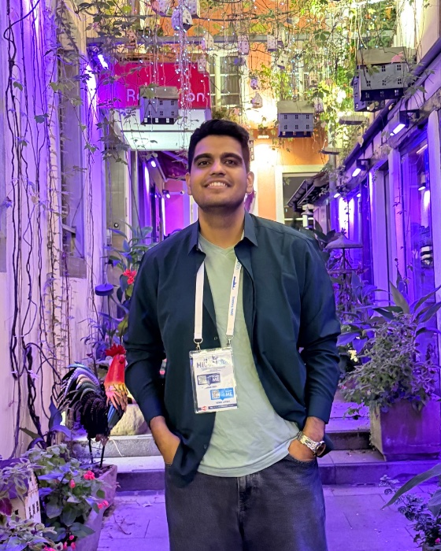
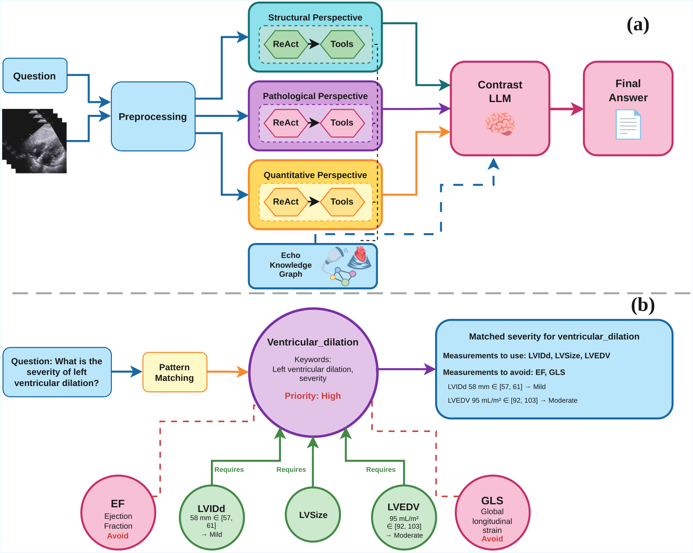
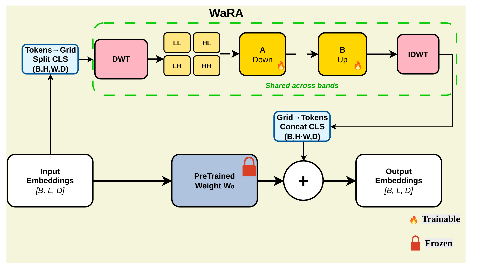
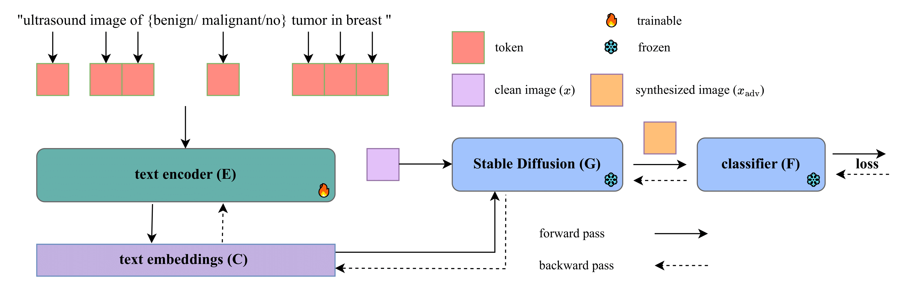
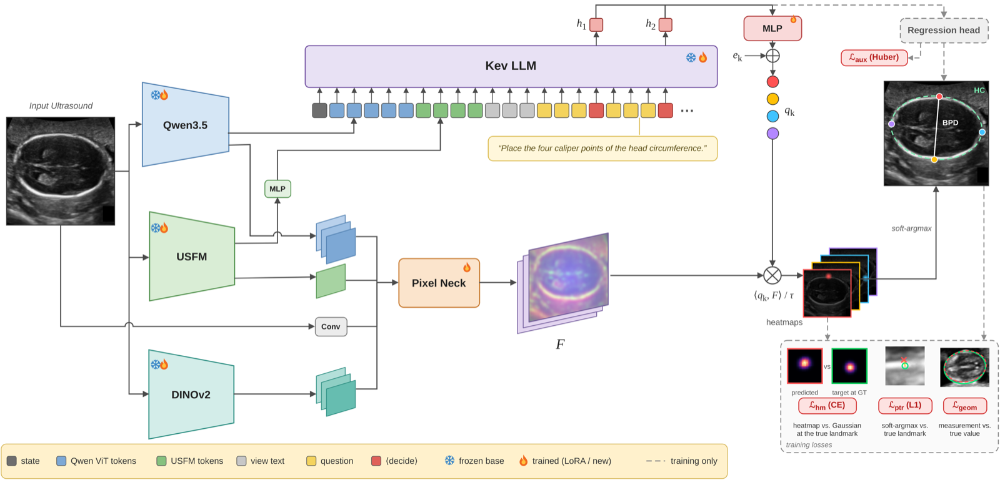
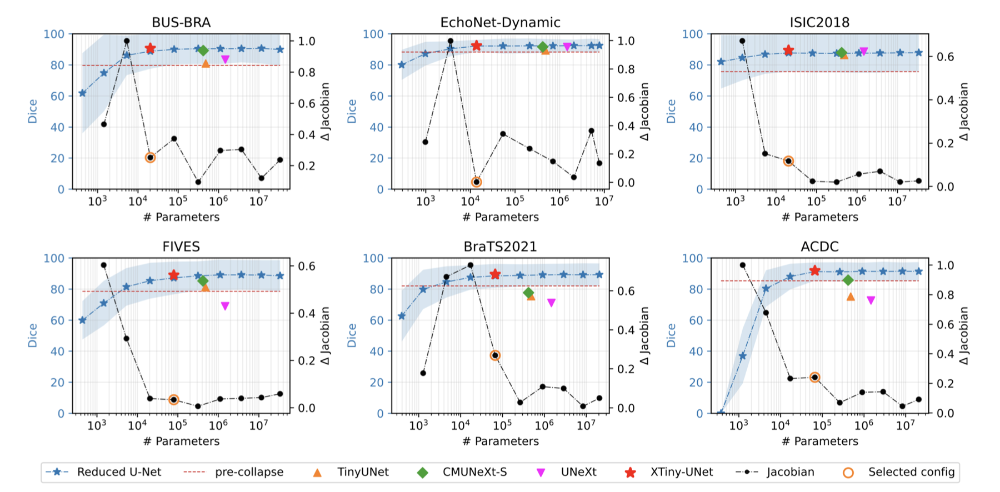

# Moein Heidari

**Ph.D. Candidate · Biomedical Engineering · University of British Columbia** 
UltrAi Lab · Pushing the boundaries of AI in healthcare.

 

  

---

### 📰 Latest

| | |
|:--|:--|
| **Nov 2026** | 🎉 *Which Pretext Task Transfers?* accepted as an **oral** at **SPIE Medical Imaging 2027** |
| **Oct 2026** | 🏆 **WaRA** won the **Impact Award** at the MIRASOL workshop, MICCAI 2026 |
| **Aug 2026** | 🎉 4 papers accepted at **MICCAI 2026 workshops** |
| **May 2026** | 🎉 **XTinyU-Net** early-accepted at **MICCAI 2026** (top 9%) |
| **Nov 2025** | 🎓 Advanced to **Ph.D. candidacy** |

### ✨ Selected work

<table>
<tr>
<td width="50%" valign="top">
 
<b>Echo-CoPilot</b> · agentic echocardiography interpretation 

<a href="https://arxiv.org/abs/2512.09944">paper</a> · <a href="https://github.com/moeinheidari7829/Echo-CoPilot">code</a>
</td>
<td width="50%" valign="top">
 
<b>WaRA</b> · wavelet low-rank adaptation 

<a href="https://arxiv.org/abs/2506.24092">paper</a> · <a href="https://github.com/moeinheidari7829/WaRA">code</a>
</td>
</tr>
<tr>
<td width="50%" valign="top">
 
<b>SL²A-INR</b> · learnable activations for INRs 

<a href="https://arxiv.org/abs/2409.10836">paper</a> · <a href="https://github.com/Iceage7/SL2A-INR">code</a>
</td>
<td width="50%" valign="top">
 
<b>Prompt2Perturb</b> · text-guided diffusion attacks on ultrasound 

<a href="https://arxiv.org/abs/2412.09910">paper</a> · <a href="https://github.com/yasamin-med/P2P">code</a>
</td>
</tr>
<tr>
<td width="50%" valign="top">
 
<b>Every Pixel Is an Option</b> · LLM-driven ultrasound biometry 

<a href="https://arxiv.org/abs/2611.03360">paper</a>
</td>
<td width="50%" valign="top">
 
<b>XTinyU-Net</b> · training-free U-Net scaling 

<a href="https://arxiv.org/abs/2605.09639">paper</a> · <a href="https://github.com/alvinkimbowa/xtinyunet">code</a>
</td>
</tr>
</table>

**[→ All 27 publications](https://moeinheidari7829.github.io/#publications)**

 

  

Reviewer · NeurIPS · ICML · ICLR · CVPR · ICCV · MICCAI · BMVC · TMLR · IEEE TMI · IEEE JBHI

